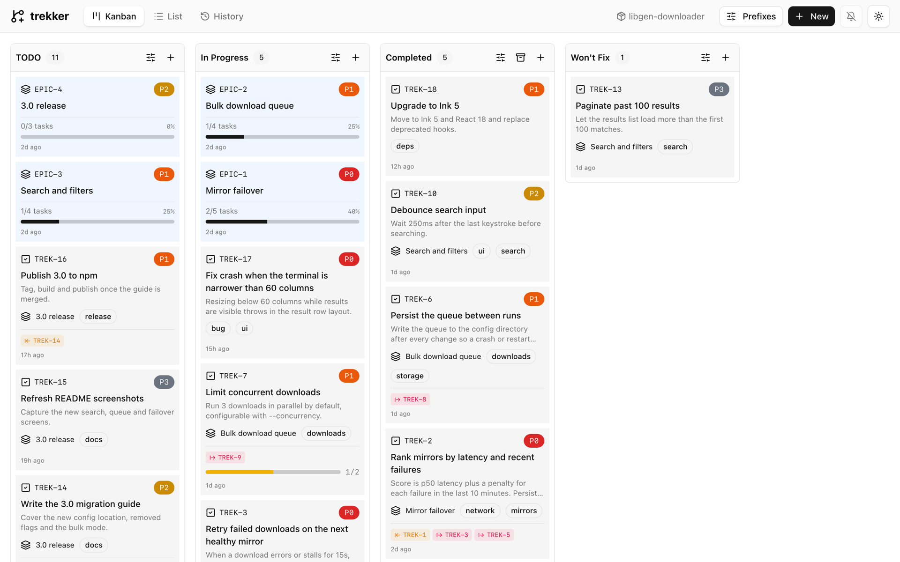

# Trekker

A small CLI issue tracker for AI coding agents. Tasks, epics, dependencies, and comments go into a SQLite file in your project. No server, no account.

## Why Trekker

Coding agents forget everything between sessions. Give them a task list they can read and update and they stay on track: they pick up where the last session left off, see what is blocked, and leave notes for the next one.

I used beads for this for a while. It worked, but the codebase grew fast without much care, and I had doubts about where it was heading and about its security. A task tracker is a simple thing and shouldn't need thousands of lines of code, so I wrote this one. I built it with AI help, but for my own daily work, so I care that it works.

## Install

Trekker runs on [Bun](https://bun.sh) (it uses `bun:sqlite`), so install Bun first, even if you use npm:

```bash
curl -fsSL https://bun.sh/install | bash
bun install -g @obsfx/trekker    # or: npm install -g @obsfx/trekker
```

## Quick start

```bash
trekker init
trekker epic create -t "User authentication"
trekker task create -t "Create the users table" -e EPIC-1 -p 1
trekker task create -t "Build the login endpoint" -e EPIC-1
trekker dep add TREK-2 TREK-1          # login waits for the table

trekker ready                          # what can I work on now?
trekker task update TREK-1 -s in_progress
trekker comment add TREK-1 -a "claude" -c "Summary: table and migration added"
trekker task update TREK-1 -s completed
```

```text
$ trekker ready
1 ready task(s) (page 1, 50 per page)

TREK-1 | P1 | Create the users table (EPIC-1)
  -> unblocks TREK-2 | todo        | P2 | Build the login endpoint
```

## Using it with agents

**Claude Code**

```bash
claude plugin marketplace add obsfx/trekker
claude plugin install trekker@trekker
```

**Codex**

```bash
codex plugin marketplace add obsfx/trekker
codex plugin add trekker@trekker
```

After installing in Codex, trust the plugin's hook with `/hooks`.

The plugins teach the agent to search before it starts, keep one task in progress, and leave a summary before closing a task. They run the `trekker` CLI directly; there is no MCP server. Details are in [plugins/claude-code](plugins/claude-code/README.md) and [plugins/codex](plugins/codex/README.md).

The plugins used to live in [trekker-claude-code](https://github.com/obsfx/trekker-claude-code) and [trekker-codex](https://github.com/obsfx/trekker-codex). Both are archived now, and their READMEs say how to switch.

**Any other agent:** tell it to "use trekker to track your work, and run `trekker quickstart` to learn how". `quickstart` prints a full guide written for agents.

## Commands

```bash
trekker init | quickstart | wipe
trekker config list | get <key> | set <key> <value> | unset <key>

trekker epic     create | list | show | update | complete | delete
trekker task     create | list | show | update | delete
trekker subtask  create | list | update | delete
trekker comment  add | list | update | delete
trekker dep      add | remove | list

trekker ready                # unblocked todo tasks, and what each one unblocks
trekker search <query>       # full-text search over everything
trekker list                 # epics, tasks, subtasks with filters and sorting
trekker history              # every create, update, and delete
```

Run `trekker <command> --help` for flags. A few things worth knowing:

- Add `--toon` before the command (`trekker --toon task show TREK-1`) for [TOON](https://github.com/toon-format/toon) output, which costs agents fewer tokens than JSON.
- Search is full-text, not semantic, and every word has to match. One keyword finds more than a sentence.
- `search --status` takes one status. For several, use `trekker list --status todo,in_progress`.
- `trekker epic complete` completes an epic and archives its tasks.

Statuses: `todo`, `in_progress`, `completed`, `wont_fix`, `archived` (epics have no `wont_fix`). Priorities run from 0 (critical) to 5 (someday); the default is 2.

IDs look like `EPIC-1`, `TREK-1`, and `CMT-1`. You can change the prefixes with `trekker init --issue-prefix FEAT` or `trekker config set issue_prefix FEAT`; existing IDs keep their old prefix.

## Dashboard

<picture>
  <source media="(prefers-color-scheme: dark)" srcset="assets/screenshots/dark-kanban.webp">
  
</picture>

A kanban board that reads the same database and updates live, so you can watch agents work:

```bash
npm install -g @obsfx/trekker-dashboard
trekker-dashboard -p 3000
```

See [trekker-dashboard](https://github.com/obsfx/trekker-dashboard).

## Data

Everything is in `.trekker/trekker.db`. Commit it or ignore it, your call. Several agents can write at once; writes wait for each other instead of failing.

## Development

```bash
bun install
bun run dev <command>     # run from source
bun test
bun run check             # lint and format
bun run typecheck
bun run test:release      # all of the above plus the Docker suite
```

To release, run `bun run release <patch|minor|major>` (add `--dry-run` to rehearse), then `git push --atomic origin HEAD vX.Y.Z`. The script reinstalls dependencies from the lockfile (like `npm ci`), runs the full test suite, bumps the CLI and both plugins to the same version, builds, publishes to npm, and tags. npm asks you to confirm the publish in the browser if your account uses two-factor auth.

## License

MIT
